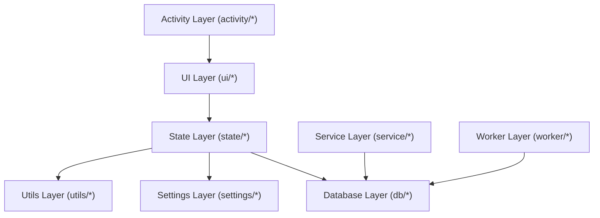
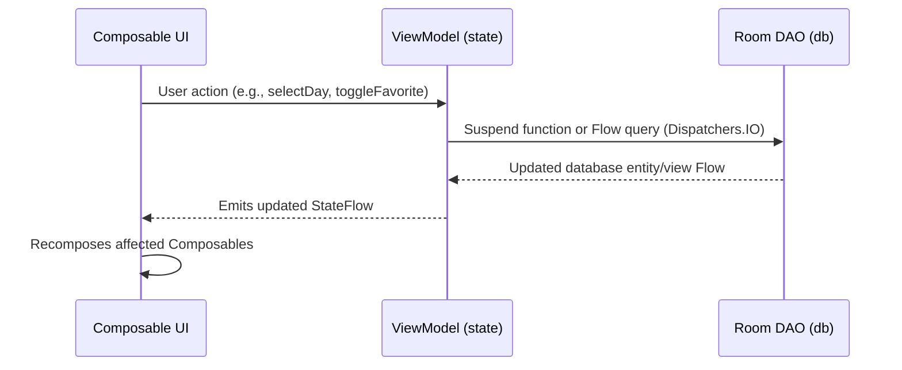

# Architecture Overview

- **Purpose**: System architecture, unidirectional dependency rules, UI state lifecycle, and data flow.
- **Audience**: Both (Human & Agent)
- **Related Source Paths**:
  - [`app/src/main/java/id/my/nanclouder/nanhistory/activity/`](file:///home/nandaahmad/Projects/AndroidStudio/NanHistory/app/src/main/java/id/my/nanclouder/nanhistory/activity/)
  - [`app/src/main/java/id/my/nanclouder/nanhistory/ui/`](file:///home/nandaahmad/Projects/AndroidStudio/NanHistory/app/src/main/java/id/my/nanclouder/nanhistory/ui/)
  - [`app/src/main/java/id/my/nanclouder/nanhistory/state/`](file:///home/nandaahmad/Projects/AndroidStudio/NanHistory/app/src/main/java/id/my/nanclouder/nanhistory/state/)
  - [`app/src/main/java/id/my/nanclouder/nanhistory/db/`](file:///home/nandaahmad/Projects/AndroidStudio/NanHistory/app/src/main/java/id/my/nanclouder/nanhistory/db/)
  - [`app/src/main/java/id/my/nanclouder/nanhistory/service/`](file:///home/nandaahmad/Projects/AndroidStudio/NanHistory/app/src/main/java/id/my/nanclouder/nanhistory/service/)
  - [`app/src/main/java/id/my/nanclouder/nanhistory/worker/`](file:///home/nandaahmad/Projects/AndroidStudio/NanHistory/app/src/main/java/id/my/nanclouder/nanhistory/worker/)
- **Last Verified Against**: 2026-11-01

---

## 1. High-Level Architecture

NanHistory uses a multi-Activity Android architecture with Jetpack Compose for UI rendering, Room for persistent local storage, and custom/ViewModel state holders.

### Layer Responsibilities

| Layer | Primary Packages | Responsibilities | Forbidden Access |
|---|---|---|---|
| **Activity** | `id.my.nanclouder.nanhistory.activity` | Entry points, Intent handling, window configuration, hosting Compose roots | Directly executing Room queries or DAOs |
| **UI** | `id.my.nanclouder.nanhistory.ui` | Declarative Composables, Material 3 layouts, user interaction callbacks | Directly calling Room DAOs or instantiating services |
| **State** | `id.my.nanclouder.nanhistory.state` | ViewModels and state holders (e.g. `SelectionState`), business logic, StateFlow emissions | UI rendering details, View references |
| **Database** | `id.my.nanclouder.nanhistory.db` | Room database instance (`AppDatabase`), entity definitions, DAO interfaces, schema migrations | Referencing `ui`, `state`, or `service` layers |
| **Background** | `id.my.nanclouder.nanhistory.service`, `worker` | Audio recording (`RecordService`), data syncing (`DataProcessService`), periodic cleanup (`AutoDeleteWorker`) | Direct UI references |

---

## 2. Unidirectional Data Flow

Screens follow a unidirectional data flow pattern:

1. **State Emission**: ViewModels and state holders in `state/` expose immutable `StateFlow<T>` streams to UI consumers.
2. **State Consumption**: Screen-level composables collect states using lifecycle-aware collectors (`collectAsStateWithLifecycle()`).
3. **Event Propagation**: Composables below screen level receive read-only state models and lambda event triggers (`onClick: () -> Unit`).
4. **Data Mutation**: ViewModels execute business logic on `Dispatchers.IO` / `Dispatchers.Default` and update underlying database entities via Room DAOs.

---

## 3. Design Decisions & Fragile Areas

- **Multi-Activity Design**: The application uses separate Activities for major feature flows (e.g., `MainActivity`, `EditEventActivity`, `EventDetailActivity`, `ShareMapActivity`, `TrashActivity`, `YearlyMapActivity`) rather than Single-Activity Navigation Compose. Inter-screen navigation uses Android explicit `Intent`s.
- **Markdown & Text Formatting Architecture**: Markdown display is handled via `utils/TextFormat.kt` (using `compose-markdown` for rich rendering, segmented with interactive `ui/component/CodeBlockCard.kt` for syntax-highlighted code blocks with language header, copy action, and line numbers) and `utils/TextParser.kt` (parsing into `AnnotatedString`). Text field syntax highlighting is powered by Foundation's `OutputTransformation` and `TextFieldState` with multi-language code highlighting (`dev.snipme:highlights` via `CodeSyntaxHighlighter.kt`), LRU token caching, and cursor-aware code fence hiding (`MarkdownOutputTransformation.kt`, `CustomExpressionOutputTransformation.kt`).
- **Direct Service/Worker DAO Access**: Because background services (`RecordService`, `DataProcessService`) and workers (`AutoDeleteWorker`) operate without UI lifecycles, they instantiate and query Room DAOs directly via `AppDatabase.getInstance(context)`.
- **Known Fragile Areas**:
  - `RecordService`: If invoked from the background without proper Android 12+/14 foreground service exemptions, Android will throw `ForegroundServiceStartNotAllowedException`.
  - `AutoDeleteWorker`: Deletion queries must enforce a hard minimum threshold of 30 days to avoid accidental data loss.

---

## 4. Open Questions & Unverified Items
- None. All architectural paths and boundaries are verified against the codebase.
