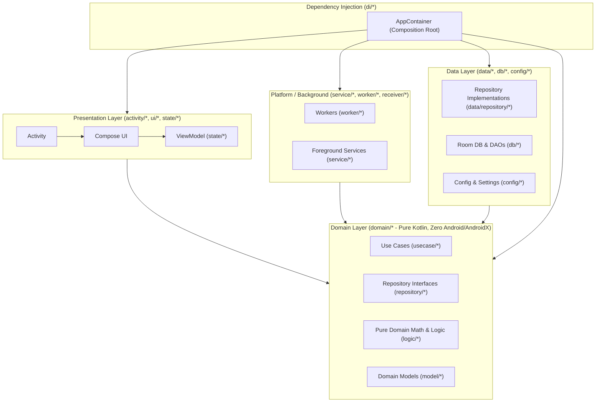

# Architecture Overview

- **Purpose**: System architecture, unidirectional dependency rules, UI state lifecycle, and data flow.
- **Audience**: Both (Human & Agent)
- **Related Source Paths**:
  - [`app/src/main/java/id/my/nanclouder/nanhistory/activity/`](file:///home/nandaahmad/Projects/AndroidStudio/NanHistory/app/src/main/java/id/my/nanclouder/nanhistory/activity/)
  - [`app/src/main/java/id/my/nanclouder/nanhistory/ui/`](file:///home/nandaahmad/Projects/AndroidStudio/NanHistory/app/src/main/java/id/my/nanclouder/nanhistory/ui/)
  - [`app/src/main/java/id/my/nanclouder/nanhistory/state/`](file:///home/nandaahmad/Projects/AndroidStudio/NanHistory/app/src/main/java/id/my/nanclouder/nanhistory/state/)
  - [`app/src/main/java/id/my/nanclouder/nanhistory/domain/`](file:///home/nandaahmad/Projects/AndroidStudio/NanHistory/app/src/main/java/id/my/nanclouder/nanhistory/domain/)
  - [`app/src/main/java/id/my/nanclouder/nanhistory/data/`](file:///home/nandaahmad/Projects/AndroidStudio/NanHistory/app/src/main/java/id/my/nanclouder/nanhistory/data/)
  - [`app/src/main/java/id/my/nanclouder/nanhistory/di/`](file:///home/nandaahmad/Projects/AndroidStudio/NanHistory/app/src/main/java/id/my/nanclouder/nanhistory/di/)
  - [`app/src/main/java/id/my/nanclouder/nanhistory/db/`](file:///home/nandaahmad/Projects/AndroidStudio/NanHistory/app/src/main/java/id/my/nanclouder/nanhistory/db/)
  - [`app/src/main/java/id/my/nanclouder/nanhistory/service/`](file:///home/nandaahmad/Projects/AndroidStudio/NanHistory/app/src/main/java/id/my/nanclouder/nanhistory/service/)
  - [`app/src/main/java/id/my/nanclouder/nanhistory/worker/`](file:///home/nandaahmad/Projects/AndroidStudio/NanHistory/app/src/main/java/id/my/nanclouder/nanhistory/worker/)
- **Last Verified Against**: 2026-11-06

---

## 1. High-Level Clean Architecture

NanHistory follows Clean Architecture principles with strict unidirectional dependencies:

### Layer Responsibilities

| Layer | Primary Packages | Responsibilities | Forbidden Access |
|---|---|---|---|
| **Presentation** | `activity`, `ui`, `state` | UI rendering, Jetpack Compose layouts, ViewModel UI state flows, user interactions | Directly calling Room DAOs or `AppDatabase`. Must interact solely via domain ports or ViewModels. |
| **Domain** | `domain.model`, `domain.repository`, `domain.usecase`, `domain.logic` | Pure business entities, repository interfaces, use cases, mathematical algorithms (corridor simplification, replay interpolation, scoring, graph evaluation) | Absolutely NO `android.*` or `androidx.*` imports (enforced by `DomainArchitectureTest`). |
| **Data** | `data.repository`, `db`, `config` | Implementation of domain repositories (`RoomEventRepository`, `RoomLocationRepository`, `RoomTagRepository`, `ConfigSettingsRepository`), database entities, DAOs, migrations | Referencing `ui`, `activity`, or `state` layers. |
| **Platform** | `service`, `worker`, `receiver` | Background jobs (`AutoDeleteWorker`, `CorridorPrecomputeWorker`, `YearlyMapWorker`), recording services | Direct UI references. Accesses repositories/usecases via `AppContainer`. |
| **DI** | `di` | Composition root (`AppContainer`) instantiating repositories, dynamic DAO provider lambdas, and use cases | No UI or rendering logic. |

---

## 2. Unidirectional Data Flow

Screens follow a unidirectional data flow pattern:

1. **State Emission**: ViewModels and state holders in `state/` expose immutable `StateFlow<T>` streams to UI consumers.
2. **State Consumption**: Screen-level composables collect states using lifecycle-aware collectors (`collectAsStateWithLifecycle()`).
3. **Event Propagation**: Composables below screen level receive read-only state models and lambda event triggers (`onClick: () -> Unit`).
4. **Repository Interaction**: ViewModels execute business transactions by delegating to pure domain repositories or use cases off the main thread (`Dispatchers.IO`).
