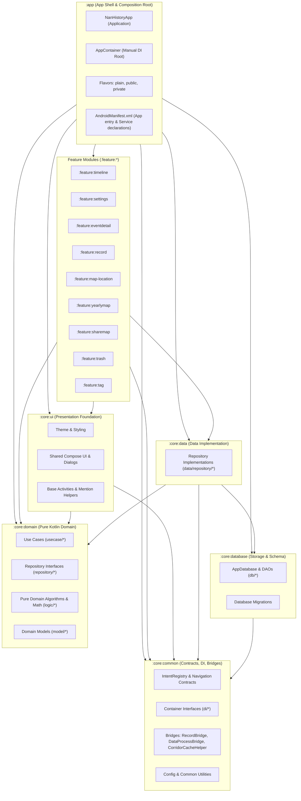

# Architecture Overview

- **Purpose**: System architecture, modular DAG dependency rules, UI state lifecycle, and data flow.
- **Audience**: Both (Human & Agent)
- **Related Source Paths**:
  - App Shell: [`app/src/main/java/id/my/nanclouder/nanhistory/`](file:///home/nandaahmad/Projects/AndroidStudio/NanHistory/app/src/main/java/id/my/nanclouder/nanhistory/)
  - Core Modules:
    - [`core/common/src/main/java/id/my/nanclouder/nanhistory/core/common/`](file:///home/nandaahmad/Projects/AndroidStudio/NanHistory/core/common/src/main/java/id/my/nanclouder/nanhistory/core/common/)
    - [`core/domain/src/main/java/id/my/nanclouder/nanhistory/domain/`](file:///home/nandaahmad/Projects/AndroidStudio/NanHistory/core/domain/src/main/java/id/my/nanclouder/nanhistory/domain/)
    - [`core/database/src/main/java/id/my/nanclouder/nanhistory/db/`](file:///home/nandaahmad/Projects/AndroidStudio/NanHistory/core/database/src/main/java/id/my/nanclouder/nanhistory/db/)
    - [`core/data/src/main/java/id/my/nanclouder/nanhistory/data/`](file:///home/nandaahmad/Projects/AndroidStudio/NanHistory/core/data/src/main/java/id/my/nanclouder/nanhistory/data/)
    - [`core/ui/src/main/java/id/my/nanclouder/nanhistory/core/ui/`](file:///home/nandaahmad/Projects/AndroidStudio/NanHistory/core/ui/src/main/java/id/my/nanclouder/nanhistory/core/ui/)
  - Feature Modules:
    - `feature:timeline`, `feature:settings`, `feature:eventdetail`, `feature:record`, `feature:map-location`, `feature:yearlymap`, `feature:sharemap`, `feature:trash`, `feature:tag`
- **Last Verified Against**: 2026-11-07

---

## 1. High-Level Modular Clean Architecture

NanHistory is architected as a modular Gradle project enforcing a strict Directed Acyclic Graph (DAG) with clean layer boundaries:

### Strict DAG & Dependency Rules

1. **Features are Isolated**: Feature modules **NEVER** depend on sibling feature modules, nor do they depend on `:app`.
2. **App Shell as Integrator**: `:app` acts as the composition root, linking all feature modules and providing the full dependency graph via `AppContainer`.
3. **Core Hierarchy**:
   - `:core:domain`: Pure Kotlin, zero Android or AndroidX dependencies. Contains models, repository ports, use cases, and mathematical logic.
   - `:core:database`: Room database definition, schema files, DAOs, and migrations.
   - `:core:data`: Concrete implementations of domain repository ports using Room and disk storage.
   - `:core:ui`: Common Compose themes, design system components, shared dialogs (e.g., `TagEditorDialog`, `MentionModal`), and base activities.
   - `:core:common`: Cross-module communication contracts, `IntentRegistry`, container interfaces for manual DI, system service bridges, and utilities.

---

## 2. Multi-Activity Navigation via IntentRegistry

Activities across features do not directly reference each other's activity classes at compile time. Instead, navigation is decoupled using the `IntentRegistry` pattern defined in `:core:common`:

1. **Registration**: At application startup, `:app` registers intent factories with `IntentRegistry` (e.g. `registerEditEventIntent`, `registerTagDetailIntent`, `registerEventLocationIntent`, `registerYearlyMapIntent`, etc.).
2. **Execution**: Features request intents via `IntentRegistry.create<Feature>Intent(context, ...)` or standard intent actions, completely decoupling features from one another.

---

## 3. Dependency Injection Architecture

NanHistory uses a lightweight manual Dependency Injection pattern:

1. **Container Interfaces**: Granular DI interfaces live in `:core:common.di` (e.g., `DomainContainerProvider`, `SettingsContainerProvider`, `CorridorContainerProvider`, `TrashContainerProvider`).
2. **Composition Root**: `AppContainer` inside `:app` implements these interfaces, holding singletons for repositories, use cases, and Room DAOs.
3. **ViewModel Factories**: ViewModels in features receive their dependencies from the application's container provider, ensuring testability and modular isolation.

---

## 4. Cross-Module Bridges

When features need to interact with background services or shared state without creating direct dependencies, they communicate through contracts in `:core:common`:

- **`RecordBridge` & `RecordingState`**: Provides lifecycle state (`isRunning`, `status`, `activeEventId`) and control actions (`restartRecording`) without coupling UI modules to `RecordService` in `:feature:record`.
- **`DataProcessBridge`**: Manages background processing triggers and state flow.
- **`CorridorCacheHelper`**: Shared utility in `:core:common` for calculating and purging corridor tile caches used across `:feature:settings` and `:feature:yearlymap`.

---

## 5. Unidirectional Data Flow

Screens follow a strict unidirectional data flow pattern:

1. **State Emission**: ViewModels in feature modules expose immutable `StateFlow<T>` streams to UI consumers.
2. **State Consumption**: Screen-level composables collect states using lifecycle-aware collectors (`collectAsStateWithLifecycle()`).
3. **Event Propagation**: Composables below screen level receive read-only state models and lambda event triggers (`onClick: () -> Unit`).
4. **Repository Interaction**: ViewModels execute business transactions by delegating to pure domain repositories or use cases off the main thread (`Dispatchers.IO`).
