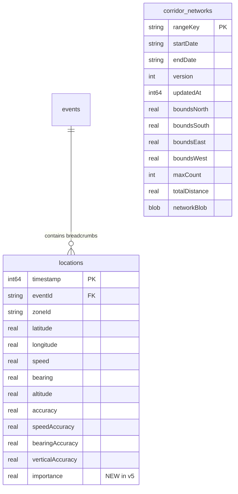
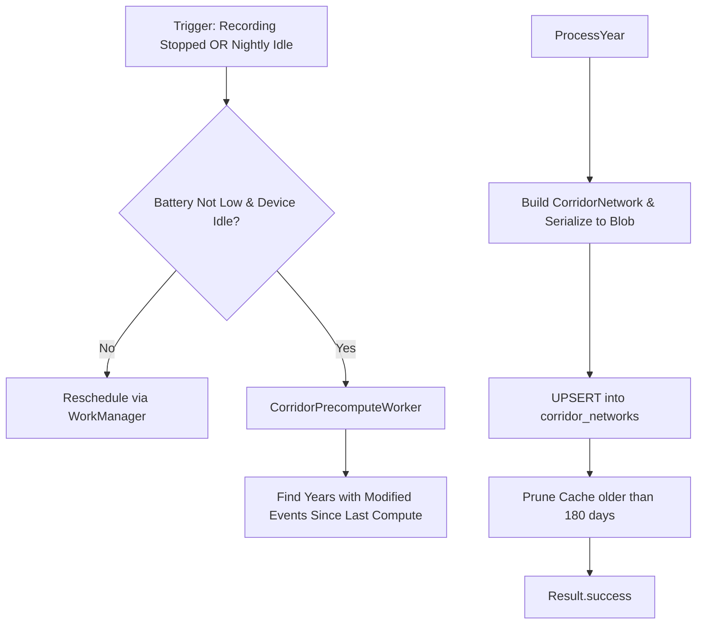

# Corridor Persistence & Background Precomputation Design

- **Status**: DRAFT / PROPOSED (Design only — no schema changes or Room version bumps in current phase)
- **Target Room Version**: `4 -> 5`
- **Audience**: Core Developers & Agents
- **Related Source Paths**:
  - `app/src/main/java/id/my/nanclouder/nanhistory/db/`
  - `app/src/main/java/id/my/nanclouder/nanhistory/ui/map/CorridorNetwork.kt`
  - `app/src/main/java/id/my/nanclouder/nanhistory/ui/map/CorridorNetworkBuilder.kt`
  - `app/src/main/java/id/my/nanclouder/nanhistory/worker/`
- **Date**: 2026-11-02

---

## 1. Executive Summary

In Phases 1–3, the Yearly / Aggregate Trips map was migrated to MapLibre Compose with an in-memory and
disk binary cache (`CorridorNetwork`). While disk caching provides fast cold starts (<50ms for cached years),
cold cache misses on large databases (e.g. 50k–1M coordinates) require fetching raw locations and performing
RDP simplification, spatial-hash snapping, and degree-2 node contraction on demand.

This design document outlines the database persistence and background processing architecture for:
1. **Query Plan Optimization**: Eliminating SQLite temporary B-trees via composite indexing.
2. **Dedicated Persistence Table**: Caching precomputed corridor networks directly inside SQLite (`corridor_networks`).
3. **Adaptive Level-of-Detail (LOD)**: Precomputing an RDP `importance` score on location rows.
4. **WorkManager Background Backfill**: Incrementally precomputing and refreshing networks during idle/charging windows.
5. **User-Controlled Invalidation**: Enabling users to manually refresh or delete persistent corridor network data.
6. **Zero-Destructive Migration Plan**: Rigorous migration verification and safe rollback strategies.

---

## 2. Room Schema Changes (Version 4 -> 5)



### 2.1 Composite Index on `locations(eventId, timestamp)`

#### Problem Statement
In schema v4, `locations` only has a single-column index on `eventId` (`index_locations_eventId`).
The query used to fetch locations:
```sql
SELECT l.*, ROW_NUMBER() OVER (PARTITION BY l.eventId ORDER BY l.timestamp ASC) AS rn
FROM locations l
...
ORDER BY eventId, timestamp ASC
```
Forces SQLite to perform a secondary sort for `ORDER BY timestamp ASC` per partition, creating an in-memory or
on-disk **temp B-tree** (`USE TEMP B-TREE FOR ORDER BY`).

#### Proposed Schema Change
Replace `index_locations_eventId` with a composite index covering both partition and sort columns:
```sql
CREATE INDEX IF NOT EXISTS index_locations_eventId_timestamp ON locations(eventId, timestamp ASC);
DROP INDEX IF EXISTS index_locations_eventId;
```
- **Performance Impact**: Eliminates `TEMP B-TREE` entirely. SQLite can stream matching index leaves in exact
  chronological order per event.
- **Index Size**: Marginal increase (~4 bytes per row for the timestamp pointer).

---

### 2.2 Dedicated Persistence Table: `corridor_networks`

#### Entity Definition
```kotlin
@Entity(tableName = "corridor_networks")
data class CorridorNetworkEntity(
    @PrimaryKey
    val rangeKey: String,           // e.g., "year_2025", "all_time", "custom_2025-01-01_2025-06-30"
    val startDate: String?,         // ISO date "YYYY-MM-DD" or null
    val endDate: String?,           // ISO date "YYYY-MM-DD" or null
    val version: Int,               // Algorithm version (YearlyMapCacheManager.ALGO_VERSION)
    val updatedAt: Long,            // System.currentTimeMillis()
    val boundsNorth: Double,
    val boundsSouth: Double,
    val boundsEast: Double,
    val boundsWest: Double,
    val maxCount: Int,
    val totalDistanceMeters: Double,
    @ColumnInfo(typeAffinity = ColumnInfo.BLOB)
    val networkBlob: ByteArray      // Serialized CorridorNetwork binary stream
)
```

#### SQL Definition
```sql
CREATE TABLE IF NOT EXISTS corridor_networks (
    rangeKey TEXT NOT NULL PRIMARY KEY,
    startDate TEXT,
    endDate TEXT,
    version INTEGER NOT NULL,
    updatedAt INTEGER NOT NULL,
    boundsNorth REAL NOT NULL,
    boundsSouth REAL NOT NULL,
    boundsEast REAL NOT NULL,
    boundsWest REAL NOT NULL,
    maxCount INTEGER NOT NULL,
    totalDistanceMeters REAL NOT NULL,
    networkBlob BLOB NOT NULL
);
```

#### Benefits
- **ACID Integrity**: Network snapshots are backed up together with the database during SAF exports and
  restored consistently.
- **Cache Eviction Control**: Unlike `context.cacheDir` which the OS can clear when device storage runs low,
  database-backed snapshots survive storage pressure.
- **Instant Query**: `SELECT * FROM corridor_networks WHERE rangeKey = :key AND version = :algoVersion`
  returns in <5ms.

---

### 2.3 Adaptive Level-of-Detail (LOD): `importance` Column on `locations`

#### Rationale
When visualizing the whole globe or large state-level bounding boxes, rendering every 10-meter vertex is
unnecessary. By assigning an `importance` score (the Douglas-Peucker perpendicular deviation distance $\epsilon$
in meters at which the point would be dropped), queries can filter:
```sql
SELECT * FROM locations WHERE eventId = :id AND (importance IS NULL OR importance >= :minEpsilon)
```
- `importance = NULL`: Uncalculated / raw point.
- `importance = 0.0`: Collinear point dropped at smallest epsilon.
- `importance = 50.0`: Major corner or intersection preserved even under aggressive simplification.

#### SQL Definition
```sql
ALTER TABLE locations ADD COLUMN importance REAL DEFAULT NULL;
CREATE INDEX IF NOT EXISTS index_locations_importance ON locations(importance);
```

---

## 3. Migration Strategy (v4 -> v5)

### 3.1 Strict Migration Rule Compliance
- `fallbackToDestructiveMigration()` is **STRICTLY FORBIDDEN**.
- Every migration must be tested using AndroidX `MigrationTestHelper`.
- Schema JSON export must be retained in `app/schemas/id.my.nanclouder.nanhistory.db.AppDatabase/5.json`.

### 3.2 Migration Script: `MIGRATION_4_5`

```kotlin
val MIGRATION_4_5 = object : Migration(4, 5) {
    override fun migrate(db: SupportSQLiteDatabase) {
        // 1. Add composite index on locations(eventId, timestamp)
        db.execSQL(
            "CREATE INDEX IF NOT EXISTS index_locations_eventId_timestamp " +
            "ON locations(eventId, timestamp ASC)"
        )
        db.execSQL("DROP INDEX IF EXISTS index_locations_eventId")

        // 2. Add importance column to locations
        db.execSQL("ALTER TABLE locations ADD COLUMN importance REAL DEFAULT NULL")
        db.execSQL("CREATE INDEX IF NOT EXISTS index_locations_importance ON locations(importance)")

        // 3. Create corridor_networks table
        db.execSQL(
            "CREATE TABLE IF NOT EXISTS corridor_networks (" +
            "rangeKey TEXT NOT NULL PRIMARY KEY, " +
            "startDate TEXT, " +
            "endDate TEXT, " +
            "version INTEGER NOT NULL, " +
            "updatedAt INTEGER NOT NULL, " +
            "boundsNorth REAL NOT NULL, " +
            "boundsSouth REAL NOT NULL, " +
            "boundsEast REAL NOT NULL, " +
            "boundsWest REAL NOT NULL, " +
            "maxCount INTEGER NOT NULL, " +
            "totalDistanceMeters REAL NOT NULL, " +
            "networkBlob BLOB NOT NULL" +
            ")"
        )
    }
}
```

### 3.3 Test Plan (`AppDatabaseMigrationTest.kt`)
1. Create database at version 4 using `helper.createDatabase(TEST_DB, 4)`.
2. Insert sample event and location records.
3. Run migration to version 5 via `helper.runMigrationsAndValidate(TEST_DB, 5, true, MIGRATION_4_5)`.
4. Verify:
   - Data in `events` and `locations` is preserved with zero row loss.
   - Newly inserted `CorridorNetworkEntity` can be stored and retrieved with exact blob fidelity.
   - `importance` defaults to `null`.
   - `EXPLAIN QUERY PLAN` confirms `index_locations_eventId_timestamp` is utilized without temporary B-trees.

---

## 4. Background Backfill & Maintenance (`WorkManager`)



### 4.1 Worker Specification
- **Class Name**: `CorridorPrecomputeWorker` (`id.my.nanclouder.nanhistory.worker.CorridorPrecomputeWorker`)
- **Constraints**:
  - `setRequiresCharging(true)`
  - `setRequiresDeviceIdle(true)`
  - `setRequiresBatteryNotLow(true)`
- **Unique Work Name**: `"corridor_precompute_periodic"` (`ExistingPeriodicWorkPolicy.KEEP`).

### 4.2 Incremental Invalidation Policy
- When an event is inserted, edited, or soft-deleted:
  - Determine the event's `date.year`.
  - Mark `corridor_networks` row for `"year_${year}"` and `"all_time"` as stale (`updatedAt = 0L` or delete row).
- `CorridorPrecomputeWorker` only computes ranges where:
  - No row exists, OR
  - `updatedAt` is older than the latest `events.modified` timestamp for events in that date range.

### 4.3 Data Safety & 30-Day Retention Invariant
- **Rule**: Workers MUST NEVER delete active user history or location data.
- Deletion in `CorridorPrecomputeWorker` is strictly restricted to precomputed cache rows (`corridor_networks`)
  and never touches `events`, `locations`, `days`, or `tags`.

---

## 5. User-Controlled Cache Deletion & Refresh Plan

To give users full transparency and control over persistent storage and recomputation, users can trigger
invalidation and refresh operations directly from the map interface as well as global storage settings.

```mermaid
flowchart TD
    subgraph YearlyMapScreen [YearlyMapScreen TopAppBar]
        RefreshBtn[Refresh Icon Button] -->|Active Range Key| ClearRange[YearlyMapCacheManager.clearRangeCache]
        ClearRange --> RecomputeActive[Recompute Active Range Network]
        
        MoreMenu[3-Dot Overflow Menu] --> ClearAllItem[Clear All Corridor Cache]
        ClearAllItem --> ConfirmDialog{User Confirms Alert Dialog?}
        ConfirmDialog -- Yes --> ClearAll[YearlyMapCacheManager.clearAllCorridorCaches]
        ClearAll --> SnackbarMsg[Show Snackbar: Corridor cache cleared]
        SnackbarMsg --> RecomputeActive
    end

    subgraph Settings [StorageSettingsActivity]
        ClearStorageBtn[Clear Corridor Map Cache Button] --> ShowSize[Displays Current Cache Footprint]
        ShowSize --> ClearAllStorage[YearlyMapCacheManager.clearAllCorridorCaches]
        ClearAllStorage --> UpdateSizes[Refresh Storage Size Breakdown]
    end
```



### 5.1 YearlyMap Screen User Experience
1. **Refresh Action Button**:
   - Placed in `YearlyMapContent`'s `TopAppBar` actions row (`Icons.Rounded.Refresh`).
   - Tapping the icon calls `viewModel.refreshCurrentRange()`.
   - Invalidates persistent binary (`.bin`) and JSON (`.json`) caches specifically for the active time range.
   - Immediately starts re-aggregating locations and building the corridor network, displaying the determinate
     linear progress bar.
2. **Overflow Menu & Confirmation Dialog**:
   - 3-dot overflow menu (`Icons.Rounded.MoreVert`) beside the refresh icon with item "Clear All Corridor Cache".
   - Tapping displays an `AlertDialog`:
     - *Title*: `R.string.clear_corridor_cache_title` ("Clear Map Cache?")
     - *Message*: `R.string.clear_corridor_cache_message` ("This will delete all saved corridor network files.
       Corridors for the active view will be recalculated.")
     - *Buttons*: `R.string.cancel` ("Cancel") and `R.string.clear` ("Clear").
   - Upon confirmation:
     - Invokes `viewModel.clearAllCachesAndRecompute()`.
     - Displays a Snackbar (`R.string.corridor_cache_cleared`, "Corridor cache cleared").
     - Recomputes the active time range immediately.

### 5.2 Storage Settings User Experience (`StorageSettingsActivity`)
1. **Dedicated Cache Clearer Button**:
   - A dedicated "Clear Corridor Map Cache" button is placed in the storage actions section.
   - Dynamically displays the combined byte size of all corridor cache files formatted with `readableSize()`
     (e.g., "Clear Corridor Map Cache (4.2 MB)").
   - Disabled when no corridor cache files exist.
2. **Execution**:
   - Runs `YearlyMapCacheManager.clearAllCorridorCaches(context)` on `Dispatchers.IO`.
   - Re-evaluates disk usage and updates storage breakdown bars asynchronously.

### 5.3 Cache Manager API (`YearlyMapCacheManager`)
```kotlin
/**
 * Deletes binary and JSON render cache files for a specific time range key.
 */
fun clearRangeCache(context: Context, key: String) {
    getNetworkCacheFile(context, key).delete()
    getRenderCacheFile(context, key).delete()
}

/**
 * Recursively deletes all cached corridor network files and legacy OSMDroid caches.
 */
fun clearAllCorridorCaches(context: Context) {
    getRenderCacheDir(context).deleteRecursively()
    getLegacyCacheDir(context).deleteRecursively()
}

/**
 * Calculates total storage bytes consumed by corridor caches.
 */
fun getCorridorCacheSize(context: Context): Long {
    val renderSize = getRenderCacheDir(context).walk().filter { it.isFile }.sumOf { it.length() }
    val legacySize = getLegacyCacheDir(context).walk().filter { it.isFile }.sumOf { it.length() }
    return renderSize + legacySize
}
```

### 5.4 ViewModel Operations (`YearlyMapViewModel`)
```kotlin
fun refreshCurrentRange() {
    val rangeKey = getRangeKey(_uiState.value.timeRange)
    context?.let { YearlyMapCacheManager.clearRangeCache(it, rangeKey) }
    loadRangeData(_uiState.value.timeRange)
}

fun clearAllCachesAndRecompute() {
    context?.let { YearlyMapCacheManager.clearAllCorridorCaches(it) }
    loadRangeData(_uiState.value.timeRange)
}
```

---

## 6. Rollback & Graceful Degradation Strategy

| Failure Scenario | Recovery / Fallback Behavior |
|---|---|
| Migration v4 $\to$ v5 fails | SQLite rolls back transaction; app remains at v4 schema. User data unaffected. |
| Corrupted `networkBlob` | `CorridorNetwork.readFrom` catches error, drops row, falls back to live compute. |
| Background worker interrupted | WorkManager retries with exponential backoff; computation is idempotent. |
| Reverting app version | `corridor_networks` and `importance` are additive; v4 queries ignore them. |

---

## 7. Implementation Gate & Sign-Off

> [!IMPORTANT]
> This document is a **design specification**. Prior to making any code changes in `db/`, bumping the database
> version in `AppDatabase.kt`, or modifying Room schemas:
> - Review and approve the table structure and migration SQL.
> - Confirm whether LOD `importance` column should be included in v5 or deferred to a later release.
> - Confirm background worker scheduling constraints.
