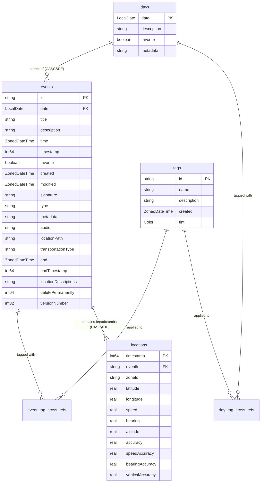

# Database Architecture & Room Schema

- **Purpose**: Reference for Room database schema (v4), entity structures, DAOs, views, converters, and manual migrations.
- **Audience**: Both (Human & Agent)
- **Related Source Paths**:
  - [`app/src/main/java/id/my/nanclouder/nanhistory/db/AppDatabase.kt`](file:///home/nandaahmad/Projects/AndroidStudio/NanHistory/app/src/main/java/id/my/nanclouder/nanhistory/db/AppDatabase.kt)
  - [`app/src/main/java/id/my/nanclouder/nanhistory/db/Tables.kt`](file:///home/nandaahmad/Projects/AndroidStudio/NanHistory/app/src/main/java/id/my/nanclouder/nanhistory/db/Tables.kt)
  - [`app/src/main/java/id/my/nanclouder/nanhistory/db/Dao.kt`](file:///home/nandaahmad/Projects/AndroidStudio/NanHistory/app/src/main/java/id/my/nanclouder/nanhistory/db/Dao.kt)
  - [`app/src/main/java/id/my/nanclouder/nanhistory/db/Views.kt`](file:///home/nandaahmad/Projects/AndroidStudio/NanHistory/app/src/main/java/id/my/nanclouder/nanhistory/db/Views.kt)
  - [`app/src/main/java/id/my/nanclouder/nanhistory/db/Converters.kt`](file:///home/nandaahmad/Projects/AndroidStudio/NanHistory/app/src/main/java/id/my/nanclouder/nanhistory/db/Converters.kt)
  - [`app/src/main/java/id/my/nanclouder/nanhistory/db/Migrations.kt`](file:///home/nandaahmad/Projects/AndroidStudio/NanHistory/app/src/main/java/id/my/nanclouder/nanhistory/db/Migrations.kt)
- **Last Verified Against**: 2026-11-01

---

## 1. Database Definition

- **Database Class**: [`AppDatabase`](file:///home/nandaahmad/Projects/AndroidStudio/NanHistory/app/src/main/java/id/my/nanclouder/nanhistory/db/AppDatabase.kt)
- **Current Version**: `5`
- **Database Name**: `"nanhistory_db"` (`AppDatabase.DATABASE_NAME`)
- **Schema Export**: Enabled (`exportSchema = true`)
- **Destructive Fallback**: STRICTLY FORBIDDEN.

---

## 2. Table & Entity Specifications

| Table Name | Entity Class | Primary Key | Key Foreign Keys & Indices |
|---|---|---|---|
| `events` | [`EventEntity`](file:///home/nandaahmad/Projects/AndroidStudio/NanHistory/app/src/main/java/id/my/nanclouder/nanhistory/db/Tables.kt#L45) | `id` (String) | Foreign Key `date` → `days.date` (ON DELETE CASCADE), Index on `date` |
| `days` | [`DayEntity`](file:///home/nandaahmad/Projects/AndroidStudio/NanHistory/app/src/main/java/id/my/nanclouder/nanhistory/db/Tables.kt#L78) | `date` (LocalDate) | None |
| `tags` | [`TagEntity`](file:///home/nandaahmad/Projects/AndroidStudio/NanHistory/app/src/main/java/id/my/nanclouder/nanhistory/db/Tables.kt#L86) | `id` (String) | None |
| `event_tag_cross_refs` | [`EventTagCrossRef`](file:///home/nandaahmad/Projects/AndroidStudio/NanHistory/app/src/main/java/id/my/nanclouder/nanhistory/db/Tables.kt) | `(eventId, tagId)` | Composite primary key referencing `events` and `tags` |
| `day_tag_cross_refs` | [`DayTagCrossRef`](file:///home/nandaahmad/Projects/AndroidStudio/NanHistory/app/src/main/java/id/my/nanclouder/nanhistory/db/Tables.kt) | `(date, tagId)` | Composite primary key referencing `days` and `tags` |
| `locations` | [`LocationEntity`](file:///home/nandaahmad/Projects/AndroidStudio/NanHistory/app/src/main/java/id/my/nanclouder/nanhistory/db/Tables.kt#L98) | `timestamp` (Long) | Foreign Key `eventId` → `events.id` (ON DELETE CASCADE), Composite Index `(eventId, timestamp)`, Index `importance` |
| `corridor_networks` | [`CorridorNetworkEntity`](file:///home/nandaahmad/Projects/AndroidStudio/NanHistory/app/src/main/java/id/my/nanclouder/nanhistory/db/CorridorNetworkEntity.kt) | `rangeKey` (String) | None |

### Database Views
- **`events_time_with_tag`** ([`Views.kt`](file:///home/nandaahmad/Projects/AndroidStudio/NanHistory/app/src/main/java/id/my/nanclouder/nanhistory/db/Views.kt)): Joins `events`, `event_tag_cross_refs`, and `tags` to expose `id`, `time`, and `tag_id`.

---

## 3. Migration History

| Version Step | Key Changes | SQL Script / Operation |
|---|---|---|
| `1 -> 2` | Added view `events_time_with_tag` | `CREATE VIEW events_time_with_tag AS SELECT events.id, events.time, tags.id as tag_id FROM events INNER JOIN event_tag_cross_refs ON events.id = event_tag_cross_refs.eventId INNER JOIN tags ON event_tag_cross_refs.tagId = tags.id` |
| `2 -> 3` | Added column `versionNumber` to `events` | `ALTER TABLE events ADD COLUMN versionNumber INTEGER NOT NULL DEFAULT 0` |
| `3 -> 4` | Created table `locations` | `CREATE TABLE IF NOT EXISTS locations (timestamp INTEGER NOT NULL PRIMARY KEY, eventId TEXT NOT NULL, zoneId TEXT NOT NULL, latitude REAL NOT NULL, longitude REAL NOT NULL, speed REAL, bearing REAL, altitude REAL, accuracy REAL, speedAccuracy REAL, bearingAccuracy REAL, verticalAccuracy REAL, FOREIGN KEY(eventId) REFERENCES events(id) ON DELETE CASCADE); CREATE INDEX index_locations_eventId ON locations(eventId);` |
| `4 -> 5` | Added composite index `(eventId, timestamp)` and `importance` on `locations`; created `corridor_networks` table | `CREATE INDEX index_locations_eventId_timestamp ON locations(eventId, timestamp ASC); DROP INDEX index_locations_eventId; ALTER TABLE locations ADD COLUMN importance REAL DEFAULT NULL; CREATE INDEX index_locations_importance ON locations(importance); CREATE TABLE corridor_networks (...);` |

---

## 4. Soft-Deletion / Trash Mechanics

- The `events` table includes `deletePermanently: Long?`.
- Normal queries exclude soft-deleted events by filtering `deletePermanently IS NULL`.
- Moving to trash sets `deletePermanently` to a future timestamp (e.g., current time + 30 days retention, or 1 hour in developer mode).
- Restoring sets `deletePermanently` back to `NULL`.
- Hard deletion occurs when `AutoDeleteWorker` executes `DELETE FROM events WHERE deletePermanently <= :now`.

---

## 5. Open Questions & Unverified Items
- None. All entities, migrations, and DAO definitions are directly verified in `db/`.
