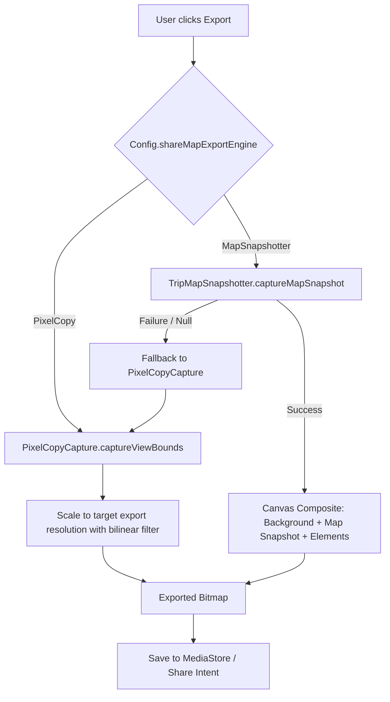

# Map Integration & OSMDroid Architecture

- **Purpose**: Reference for OpenStreetMap (OSMDroid) configuration, tile caching, Compose lifecycle integration, and MapLibre status.
- **Audience**: Both (Human & Agent)
- **Related Source Paths**:
  - [`app/src/main/java/id/my/nanclouder/nanhistory/ui/map/`](file:///home/nandaahmad/Projects/AndroidStudio/NanHistory/app/src/main/java/id/my/nanclouder/nanhistory/ui/map/)
  - [`app/src/main/java/id/my/nanclouder/nanhistory/activity/EventLocationActivity.kt`](file:///home/nandaahmad/Projects/AndroidStudio/NanHistory/app/src/main/java/id/my/nanclouder/nanhistory/activity/EventLocationActivity.kt)
  - [`app/src/main/java/id/my/nanclouder/nanhistory/activity/YearlyMapActivity.kt`](file:///home/nandaahmad/Projects/AndroidStudio/NanHistory/app/src/main/java/id/my/nanclouder/nanhistory/activity/YearlyMapActivity.kt)
  - [`app/src/main/java/id/my/nanclouder/nanhistory/activity/MapLibreTest.kt`](file:///home/nandaahmad/Projects/AndroidStudio/NanHistory/app/src/main/java/id/my/nanclouder/nanhistory/activity/MapLibreTest.kt)
- **Last Verified Against**: 2026-11-04

---

## 1. Overview & Library Configuration

NanHistory integrates `org.osmdroid:osmdroid-android:6.1.20` as its primary map provider for rendering event locations and aggregate trip paths.

### User-Agent Requirement
OSM public tile servers strictly require a descriptive, non-default user-agent. The application ID (`id.my.nanclouder.nanhistory`) MUST be configured prior to initializing any `MapView`:

```kotlin
Configuration.getInstance().userAgentValue = context.packageName
```

### Tile Storage & Caching
- Base path and tile cache MUST point to app-specific internal storage (`context.filesDir` / `context.cacheDir`) rather than root external storage.
- Storage size caps must be observed to prevent unchecked disk growth.
- **Bulk Downloading Prohibition**: Bulk downloading of tiles from standard public OpenStreetMap servers is FORBIDDEN per OSM tile usage policies.
- **Offline Behavior**: The map displays locally cached tiles and MUST gracefully handle network absence without crashing.

---

## 2. Compose Lifecycle Integration

Because `MapView` is a traditional Android View, embedding it within Jetpack Compose requires an `AndroidView` coupled with lifecycle observation:

```mermaid
flowchart TD
    ComposeRoot[Composable Screen] --> AndroidViewBlock[AndroidView Container]
    AndroidViewBlock --> CreateMapView[MapView Factory]
    ComposeRoot --> Disposable[DisposableEffect with LifecycleOwner]
    
    Disposable -->|ON_RESUME| Resume[mapView.onResume()]
    Disposable -->|ON_PAUSE| Pause[mapView.onPause()]
    Disposable -->|onDispose / ON_DESTROY| Detach[mapView.onDetach()]
```

### Mandated Lifecycle Pattern
```kotlin
@Composable
fun OsmMapView(
    modifier: Modifier = Modifier,
    onMapReady: (MapView) -> Unit
) {
    val context = LocalContext.current
    val lifecycleOwner = LocalLifecycleOwner.current
    var mapView: MapView? by remember { mutableStateOf(null) }

    AndroidView(
        factory = { ctx ->
            MapView(ctx).apply {
                setMultiTouchControls(true)
                onMapReady(this)
                mapView = this
            }
        },
        modifier = modifier
    )

    DisposableEffect(lifecycleOwner) {
        val observer = LifecycleEventObserver { _, event ->
            when (event) {
                Lifecycle.Event.ON_RESUME -> mapView?.onResume()
                Lifecycle.Event.ON_PAUSE -> mapView?.onPause()
                Lifecycle.Event.ON_DESTROY -> mapView?.onDetach()
                else -> Unit
            }
        }
        lifecycleOwner.lifecycle.addObserver(observer)
        onDispose {
            lifecycleOwner.lifecycle.removeObserver(observer)
            mapView?.onDetach()
        }
    }
}
```

---

## 3. Rendered Viewport & Zoom Downsampling Architecture

To prevent loading tens of thousands of GPS coordinates into memory when viewing event tracks, the modern `EventLocationScreen` queries only rendered locations:
- **Viewport Bounds**: The visible `BoundingBox` is padded with a 20% margin (`latitudeSpan * 0.2`, `longitudeSpan * 0.2`) to ensure smooth continuous polyline rendering during map pan.
- **Zoom Downsampling**: `step = (1 shl maxOf(0, 15 - zoomLevel.roundToInt())).coerceAtMost(2048)`.
  - Zoom >= 15: step = 1 (every location point is rendered).
  - Zoom 14: step = 2 (every 2nd point).
  - Zoom 10: step = 32.
  - Zoom 4: step = 2048.
- **Debounce**: Viewport changes from `onScroll` and `onZoom` are debounced by 200ms before executing the Room database query via `EventLocationViewModel`.
- **Cut Mode Accuracy**: Slicing an event operates on timestamps rather than in-memory list indices, querying Room directly for all records between `cutStart` and `cutEnd`.

---

## 4. Aggregate & Yearly Trips Map Architecture (MapLibre Compose)

`YearlyMapScreen` visualizes aggregated historical trips across time ranges (All Time, specific Years, or Custom Date Ranges) backed by Room queries and rendered via Compose-native MapLibre:
- **Decoupled Whole-Range Pipeline & Binary Cache**:
  - The corridor network is precomputed once per active time range (`CorridorNetwork`, `CorridorNetworkBuilder`).
  - Network snapshots are persisted to disk using compact, high-performance binary serialization (`YearlyMapCacheManager.saveNetworkBinary` / `loadNetworkBinary`), loading in <50ms on cold start.
  - Map pan and zoom are completely decoupled from database queries and corridor re-merging; GPU rasterization handles all continuous camera movement at 60/120 FPS.
- **Corridor Vertex Network Snapping (`YearlyMapMergeLogic` & `YearlyMapContraction`)**:
  - Accuracy filtering: Points with accuracy > 50m are dropped before simplification.
  - Track splitting: Tracks are split into separate subtracks across GPS gaps (displacements $\ge 5\text{km}$, temporal gaps $> 120\text{s}$ with $> 200\text{m}$ displacement, or speeds $> 70\text{m/s}$).
  - Simplification: Raw subtracks are simplified using Ramer-Douglas-Peucker (RDP with $\epsilon = 5$m) to eliminate jitter.
  - Resampling: Simplified tracks are resampled at 20m intervals.
  - Nearest-node snapping: Snaps to the minimum distance candidate within a 25m spatial hash radius.
  - Self-snapping prevention: Points within $2 \times \text{tolerance}$ (50m) along the same track cannot snap to each other, preventing false self-intersections and loops.
  - Degree-2 node contraction: Intermediate vertices having degree 2 and sharing identical `eventIds` are contracted into polylines, collapsing node count by up to 60%.
- **Logarithmic Frequency Scale & Zoom-Aware Widths**:
  - Logarithmic color scale: $t = \ln(\text{count}) / \ln(\text{maxCount})$ with a 0.08 base threshold jump for multiple trips, ensuring heavy commute corridors do not wash out occasional routes.
  - 9 GPU color stops hoisted in `CorridorColorScale.COLOR_STOPS` for seamless shader gradient interpolation.
  - Zoom-dependent widths: 1..3dp at z6 expanding to 4..12dp at z14 (casing 3..5dp to 6..14dp).
  - Frequency legend: sleek bottom-right overlay card displaying the color gradient with min (1) and max trip counts.
- **Immutable Render Contract (`CorridorRender`)**:
  - Feature properties contain only `"id"` (e.g. `"e0"`) and `"t"` formatted to 3 decimals.
  - Deduplicated string pool: `eventIdPool: Array<String>` and `edgeEventIndices: Array<IntArray>` in memory eliminate duplicated event ID strings.
- **CustomGeometrySource vs GeoJsonSource Evaluation**:
  - MapLibre Compose 0.20.0 exposes `rememberCustomGeometrySource` (`GeometryTileProvider`).
  - On Android Vulkan, passing the topologically contracted polyline network to `GeoJsonSource` avoids per-tile JNI/FFI crossing overhead and provides silky 60/120 FPS GPU rendering across all zoom levels with zero tile re-merging.
- **Vector Base Styles & Layer Anchoring**:
  - Base vector styles are powered by **OpenFreeMap** (`https://openfreemap.org`), providing vector tiles derived from OpenStreetMap and OpenMapTiles without requiring API keys or rate registration.
  - Light theme: `Positron` (`https://tiles.openfreemap.org/styles/positron`), a high-contrast muted grayscale style.
  - Dark theme: `Dark` (`https://tiles.openfreemap.org/styles/dark`), a dark matter variant for low-light legibility.
  - Layer anchoring: `Anchor.Top { ... }` ensures corridor lines and casing render cleanly above vector landuse and road polygons.
  - **Zero-Network Fallback**: Bundled fallback styles (`fallback_style.json` & `fallback_style_dark.json`) in assets ensure zero crashes offline.

---

## 5. MapLibre Integration Status

- **Primary MapLibre Use**: `YearlyMap`, `EventLocationScreen` (modern UI), `EventDetail` route preview (`TripPreviewMap`), `EventListHeader_New`, and `ShareMap` are migrated to **MapLibre Compose** (`org.maplibre.compose:maplibre-compose:0.20.0`) with the **Vulkan runtime** (`org.maplibre.compose:maplibre-compose-runtime-vulkan-android:0.20.0`).
- **Vector Base Style**: Fully migrated from raster OSM tiles to vector styles (`MapStyleConfig`, `BaseMapStyle`) with OpenFreeMap and bundled zero-network offline fallbacks.
- **Isolation Boundary**: All MapLibre Compose imports are strictly confined to `id.my.nanclouder.nanhistory.ui.map.maplibre` (`CorridorMap.kt`, `EventLocationMap.kt`, `TripPreviewMap.kt`, `TripMapSnapshotter.kt`, `EventMapGeoJsonBuilder.kt`, `BaseMapStyle.kt`, `MapStyleConfig.kt`). UI screens (`YearlyMapContent.kt`, `MapHistoryView.kt`, `DetailContent.kt`, `EventListHeader.kt`, `ShareMap.kt`) interact exclusively through standard Compose slots and immutable state.
- **Event Location Replay**: Interactive chronological playback on `EventLocationMap` with real-time coordinate interpolation, bearing azimuth calculation, discrete speed slider (0.25x - 50x), follow-camera centering, dynamic traveled trail styling, pulsing accuracy halo, stationary dwell indicators, and floating telemetry HUD.
- **Data Mode Colored Polylines**: Full parity with legacy OSMDroid data modes (`SPEED`, `ACCELERATION`, `TIME`, `ACCURACY`, `BEARING`, `ALTITUDE`). `EventMapGeoJsonBuilder` dynamically slices the route into 2-point segments with `"color": "#RRGGBB"` properties, styled dynamically on the GPU by `EventLocationMap` using MapLibre expressions for both the base path and traveled replay trail.
- **Customizable Drag-and-Drop ShareMap**: Interactive canvas in `ShareMap.kt` powered by `ShareCanvasTransformer`, allowing users to drag, resize, rotate, and style floating elements (Title, Telemetry Badges, Mini Map, Markdown Text) with normalized coordinates across 1:1, 9:16, and 16:9 aspect ratios.
- **ShareMap Dual-Engine Image Export**: See Section 6 for details on `MapSnapshotter` and `PixelCopyCapture`.
- **OSMDroid Coexistence**: OSMDroid remains strictly isolated to legacy old UI paths (`MapHistoryViewOld` in `activity.eventLocation.oldUi` and `MapHistoryPreviewOld` in `activity.eventDetail.oldUi`). All modern screens use MapLibre.

---

## 6. ShareMap Image Export Pipeline

Exporting the ShareMap card to a bitmap requires capturing both the underlying MapLibre map and the user-customized Compose overlay elements.

### Root Cause of Blank Map in Native Compose Recording
`MapLibreMap` renders using an `AndroidExternalSurface` (`SurfaceView`). `SurfaceView` draws directly to a hardware layer composed by Android's `SurfaceFlinger`, completely bypassing the View hierarchy's and Jetpack Compose's `DrawScope` / DisplayList. As a result, standard Jetpack Compose graphics recording (`graphicsLayer.record { drawContent() }` / `toImageBitmap()`) captures only Compose draw calls (solid card background, text, badges), leaving the map area completely blank (transparent/background color).

### Dual-Engine Export Architecture
To support high-resolution offscreen rendering as well as robust fallback across diverse hardware, NanHistory implements a dual-engine architecture configurable via `ExperimentalSettingsActivity` (`Config.shareMapExportEngine`):

1. **MapSnapshotter Engine (`ShareMapExportEngine.MapSnapshotter` - Default & Recommended)**:
   - Uses MapLibre's native offscreen renderer (`runtime.createSnapshotter`).
   - Renders vector tiles, route polyline casing, route core lines, and start/finish pins offscreen directly to an Android `android.graphics.Bitmap` at the exact requested export resolution (Standard 1080p, High 2K, Ultra 4K).
   - In `ShareMapScreen`, the Compose overlay elements (`ShareCanvasTransformer`) are recorded via `graphicsLayer.record` with a transparent background.
   - The final export image is composited on a native `android.graphics.Canvas`:
     1. Rounded card background (with user-selected card color).
     2. High-resolution map snapshot bitmap clipped to card boundaries.
     3. High-resolution transparent Compose element layer (scaled via bilinear filtering matrix).
   - If `MapSnapshotter` fails (e.g., native driver crash or style loading error), it automatically logs a warning and falls back to `PixelCopyCapture`.

2. **PixelCopy Engine (`ShareMapExportEngine.PixelCopy` / Fallback)**:
   - Uses Android's `PixelCopy.request` on the host Activity window (`PixelCopyCapture.captureViewBounds`).
   - Captures the exact composited pixels from the hardware framebuffer within the card's screen bounds (obtained via `onGloballyPositioned`).
   - Scales the screen-resolution capture to the selected export preset (1080p, 2K, 4K) using an anti-aliased bitmap canvas with bilinear filtering (`isFilterBitmap = true`).



### Configuration & Settings
- Setting key: `Config.shareMapExportEngine` stored in `SharedPreferences`.
- Accessible in `Settings` -> `Experimental Settings` -> `Share Map Export Engine`.
- Options:
  - `MapSnapshotter` (`R.string.settings_experimental_export_engine_snapshotter`): High-resolution vector snapshot (Default).
  - `PixelCopy` (`R.string.settings_experimental_export_engine_pixelcopy`): Framebuffer screen capture.

---

## 7. Open Questions & Unverified Items
- None. OSMDroid coexistence, MapLibre Compose Vulkan runtime, and ShareMap dual-engine export pipeline are verified in the build and test suites.
