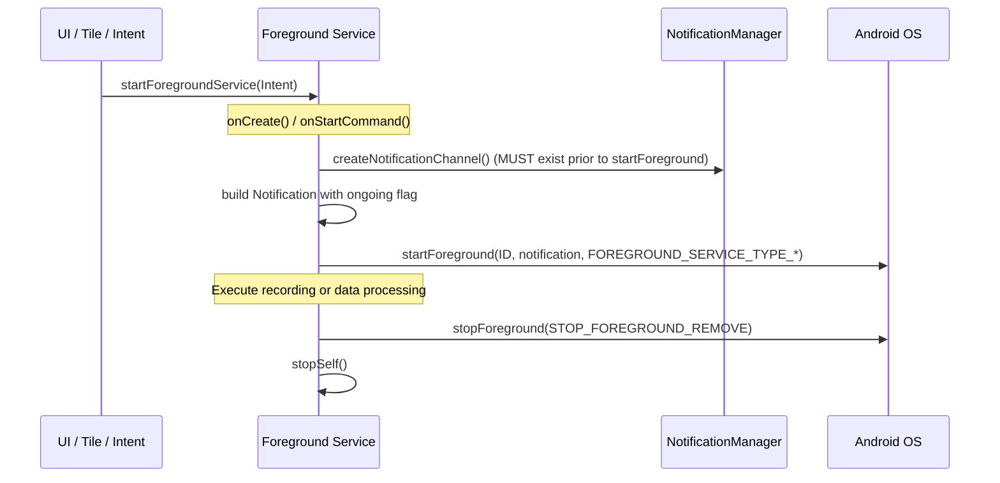

# Background Services & Workers Architecture

- **Purpose**: Reference for lifecycles, notification channels, foreground service types, and WorkManager jobs.
- **Audience**: Both (Human & Agent)
- **Related Source Paths**:
  - [`app/src/main/java/id/my/nanclouder/nanhistory/service/RecordService.kt`](file:///home/nandaahmad/Projects/AndroidStudio/NanHistory/app/src/main/java/id/my/nanclouder/nanhistory/service/RecordService.kt)
  - [`app/src/main/java/id/my/nanclouder/nanhistory/service/DataProcessService.kt`](file:///home/nandaahmad/Projects/AndroidStudio/NanHistory/app/src/main/java/id/my/nanclouder/nanhistory/service/DataProcessService.kt)
  - [`app/src/main/java/id/my/nanclouder/nanhistory/service/RecordTileService.kt`](file:///home/nandaahmad/Projects/AndroidStudio/NanHistory/app/src/main/java/id/my/nanclouder/nanhistory/service/RecordTileService.kt)
  - [`app/src/main/java/id/my/nanclouder/nanhistory/worker/AutoDeleteWorker.kt`](file:///home/nandaahmad/Projects/AndroidStudio/NanHistory/app/src/main/java/id/my/nanclouder/nanhistory/worker/AutoDeleteWorker.kt)
  - [`app/src/main/AndroidManifest.xml`](file:///home/nandaahmad/Projects/AndroidStudio/NanHistory/app/src/main/AndroidManifest.xml)
- **Last Verified Against**: 2026-11-01

---

## 1. Services & Workers Matrix

| Component | Type | `foregroundServiceType` | Notification Channel ID | Primary Purpose |
|---|---|---|---|---|
| [`RecordService`](file:///home/nandaahmad/Projects/AndroidStudio/NanHistory/app/src/main/java/id/my/nanclouder/nanhistory/service/RecordService.kt) | Foreground Service | `location\|microphone` | `"Record"` / `"RecordDebug"` | Real-time audio recording, GPS track collection, sensor logging |
| [`DataProcessService`](file:///home/nandaahmad/Projects/AndroidStudio/NanHistory/app/src/main/java/id/my/nanclouder/nanhistory/service/DataProcessService.kt) | Foreground Service | `dataSync` | `"DataProcess"` | Exporting backups, importing archives, rebuilding caches |
| [`RecordTileService`](file:///home/nandaahmad/Projects/AndroidStudio/NanHistory/app/src/main/java/id/my/nanclouder/nanhistory/service/RecordTileService.kt) | Quick Settings Tile Service | N/A | N/A | Toggling `RecordService` state from the Android quick settings shade |
| [`AutoDeleteWorker`](file:///home/nandaahmad/Projects/AndroidStudio/NanHistory/app/src/main/java/id/my/nanclouder/nanhistory/worker/AutoDeleteWorker.kt) | WorkManager `CoroutineWorker` | N/A | `"AutoDelete"` | Deferrable batch deletion of soft-deleted events older than 30 days |

---

## 2. Foreground Service Lifecycle & Channel Rules

### Critical Service Rules
1. **Notification Channel Pre-Creation**: The notification channel (`Record`, `DataProcess`) MUST be registered with `NotificationManager` before `startForeground()` is invoked.
2. **Foreground Service Types**:
   - `RecordService` MUST declare and pass `ServiceInfo.FOREGROUND_SERVICE_TYPE_LOCATION | ServiceInfo.FOREGROUND_SERVICE_TYPE_MICROPHONE`.
   - `DataProcessService` MUST declare and pass `ServiceInfo.FOREGROUND_SERVICE_TYPE_DATA_SYNC`.
3. **Android 12+ / 14 Restrictions**: Foreground services cannot be started while the app is in the background without an approved exemption.
4. **Power & Wake Lock Scoping**: `RecordService` partial wake lock is strictly bounded to active recording (`startEventRecording()` with a 4-hour timeout) and released when recording stops or transitions to idle.
5. **Two-Stage Shake Detection**: In idle or shake-enabled mode, only the wake-up accelerometer is registered with hardware FIFO batching (~20 Hz, 3s latency). The gyroscope is dynamically registered only for a 1.5-second confirmation window when acceleration exceeds the threshold.
6. **Notification Optimization & Chronometer**: `RecordService` uses `RemoteViews.setChronometer()` for elapsed duration rendering directly in SystemUI, eliminating CPU wake-ups from app-side timers. Notification channels use `IMPORTANCE_LOW` with `setOnlyAlertOnce(true)`. Notification redraws are suppressed when the device screen is off.
7. **Adaptive GNSS & Stationary State Machine**: `RecordService` dynamically adapts GPS sampling intervals across speed buckets with a 3-fix hysteresis counter. Hardware batching is screen-aware (2s delay when screen is on, up to 30s FIFO delay when screen is off). When stationary (>90s at anchor), GNSS polling is suspended and gated behind hardware `Sensor.TYPE_SIGNIFICANT_MOTION`. Location callbacks run on a dedicated `HandlerThread` ("RecordServiceLocationThread").
8. **Batched Persistence & In-Memory Jitter Filtering**: `RecordService` buffers candidate location fixes in memory (`locationBuffer`) without immediate Room database inserts, eliminating SQLite insert-then-delete churn. `iterateLocations()` runs asynchronously via coroutines (`withContext(Dispatchers.IO)`) on periodic batches, stationary transitions, and recording stop, batch-inserting graduated locations with `dao.insertLocations()`.
9. **Sensor-Hub Gated Shake Detection (Tier 2)**: When idle waiting for shake-to-start, the accelerometer is powered off and gated behind `Sensor.TYPE_SIGNIFICANT_MOTION`. When motion triggers, a 15-second listen window activates the accelerometer; if no shake occurs within 15 seconds, the accelerometer unregisters and the trigger re-arms, achieving near-zero idle drain.
10. **Activity Recognition Transitions (Tier 1)**: `ActivityRecognitionEngine` registers Play Services activity transitions (`IN_VEHICLE`, `ON_BICYCLE`, `RUNNING`, `WALKING`, `STILL`). Start events dispatch `ACTION_RECORD_START`; `STILL` events start a configurable grace timer (default 3 min) that auto-stops and finalizes recording if stillness persists.
11. **External Automation (Tier 3)**: `RecordAutomationReceiver` handles external broadcast actions (`id.my.nanclouder.nanhistory.action.START_RECORDING`, `STOP_RECORDING`, `TOGGLE_RECORDING`) guarded by an optional passkey.

---

## 3. WorkManager Job Specifications

- **Worker**: [`AutoDeleteWorker`](file:///home/nandaahmad/Projects/AndroidStudio/NanHistory/app/src/main/java/id/my/nanclouder/nanhistory/worker/AutoDeleteWorker.kt)
- **Work Type**: `CoroutineWorker`
- **Execution Flow**:
  1. Queries database for soft-deleted events (`dao.getDeletedEvents()`).
  2. Compares `deletePermanently` timestamp against `Instant.now().toEpochMilli()`.
  3. Executes `safeDelete()` which removes associated audio and breadcrumb files.
  4. Optionally posts a completion notification to `"AutoDelete"` channel if enabled by user configuration.
- **Constraints**: Deferrable, non-critical, runs periodically under network/battery constraints.

---

## 4. Design Decisions & Fragile Areas

- **Fragile - Android 14 Background Service Start**: `RecordService` will fail with `ForegroundServiceStartNotAllowedException` if an attempt is made to start it from the background without a user-triggered foreground context (such as an Activity tap or an approved Quick Settings tile tap).
- **Fragile - 30-Day Permanent Deletion Rule**: `AutoDeleteWorker` enforces a strict 30-day grace period for soft-deleted items. Under no circumstances should non-expired items be purged.

---

## 5. Open Questions & Unverified Items
- None. Service declarations and worker logic are fully verified against `AndroidManifest.xml` and Kotlin sources.
