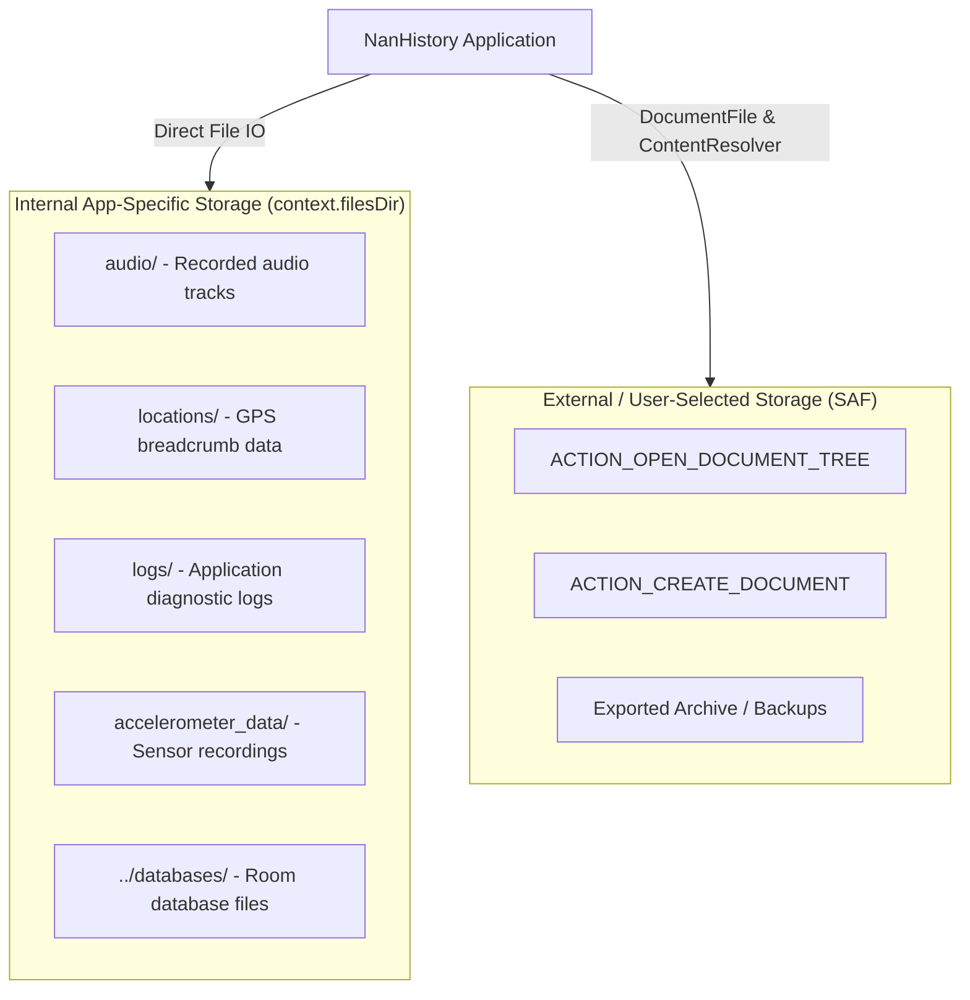

# Storage Architecture & Storage Access Framework (SAF)

- **Purpose**: File storage patterns, Storage Access Framework (SAF) import/export flows, persistable URI management, and internal storage rules.
- **Audience**: Both (Human & Agent)
- **Related Source Paths**:
  - [`app/src/main/java/id/my/nanclouder/nanhistory/utils/LegacyImport.kt`](file:///home/nandaahmad/Projects/AndroidStudio/NanHistory/app/src/main/java/id/my/nanclouder/nanhistory/utils/LegacyImport.kt)
  - [`app/src/main/java/id/my/nanclouder/nanhistory/settings/BackupActivity.kt`](file:///home/nandaahmad/Projects/AndroidStudio/NanHistory/app/src/main/java/id/my/nanclouder/nanhistory/settings/BackupActivity.kt)
  - [`app/src/main/java/id/my/nanclouder/nanhistory/settings/StorageSettingsActivity.kt`](file:///home/nandaahmad/Projects/AndroidStudio/NanHistory/app/src/main/java/id/my/nanclouder/nanhistory/settings/StorageSettingsActivity.kt)
  - [`app/src/main/java/id/my/nanclouder/nanhistory/service/DataProcessService.kt`](file:///home/nandaahmad/Projects/AndroidStudio/NanHistory/app/src/main/java/id/my/nanclouder/nanhistory/service/DataProcessService.kt)
- **Last Verified Against**: 2026-11-01

---

## 1. Storage Boundaries & Division

The application enforces a strict separation between internal private app data and user-visible file exports:



---

## 2. Storage Rules & Constraints

| Storage Context | Permitted Mechanism | Path / API | Forbidden |
|---|---|---|---|
| **Internal Data** | App-specific internal directory | `context.filesDir`, `context.cacheDir` | Raw external storage paths (`/sdcard/`, `Environment.getExternalStorageDirectory()`) |
| **User Exports** | Storage Access Framework (SAF) | `Intent.ACTION_CREATE_DOCUMENT`, `DocumentFile` | Writing directly to shared storage without SAF |
| **User Imports** | Storage Access Framework (SAF) | `Intent.ACTION_OPEN_DOCUMENT_TREE`, `DocumentFile.fromTreeUri()` | `requestLegacyExternalStorage` flag |

---

## 3. URI Permission Persistence Flow

When user grants access to a directory tree or document via SAF:
1. Obtain the result URI from Activity Result (`data?.data`).
2. Persist the permission across device reboots:
   ```kotlin
   val flags = Intent.FLAG_GRANT_READ_URI_PERMISSION or Intent.FLAG_GRANT_WRITE_URI_PERMISSION
   context.contentResolver.takePersistableUriPermission(uri, flags)
   ```
3. Store the URI string in preferences or configuration.
4. **Validation Check**: Prior to accessing a stored URI, check if permissions remain valid (e.g. using `DocumentFile.fromTreeUri(context, uri).canRead()`), and gracefully prompt the user if access was revoked.

---

## 4. Open Questions & Unverified Items
- None. Storage operations, SAF calls, and internal directory paths are directly verified in the codebase.
